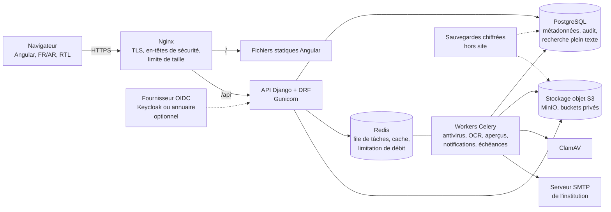

# 01. Architecture proposée

## 1.1 Synthèse

Un **monolithe modulaire** : un seul backend Django découpé en modules métier indépendants, une interface Angular, une base PostgreSQL, un stockage objet compatible S3 et des workers asynchrones pour les traitements lourds (antivirus, OCR, aperçus, notifications). Le tout est déployé en conteneurs sur l'infrastructure de l'institution.

Pourquoi pas des microservices : pour quelques centaines d'utilisateurs et une petite équipe d'exploitation, ils multiplient les points de panne, les sauvegardes et les transactions distribuées, sans gain. Le découpage en modules à frontières explicites garde la possibilité d'extraire un service plus tard (par exemple l'OCR) si la charge le justifie.

## 1.2 Séparation des couches

| Couche | Responsabilité | Règle |
|---|---|---|
| Interface (Angular) | Affichage, saisie, ergonomie | Aucune règle d'autorisation n'y est décidée : elle masque des menus, le backend décide |
| API (DRF) | Validation des entrées, sérialisation, pagination | Ne contient pas de logique métier, appelle les services |
| Services métier | Règles de gestion, transactions | Chaque opération critique tient dans une transaction et écrit son événement d'audit dans la même transaction |
| Politique d'accès | Une seule bibliothèque `acces` | Toute liste, recherche, statistique ou téléchargement passe par elle |
| Données (ORM, PostgreSQL) | Persistance, contraintes d'intégrité | Les invariants critiques sont aussi des contraintes SQL (unicité, clés étrangères, CHECK) |
| Stockage documentaire | Octets des fichiers | Jamais exposé directement au navigateur |
| Services transversaux | Audit, notifications, numérotation, paramètres | Appelés par les modules, sans dépendance inverse |

## 1.3 Modules du backend

| Module (application Django) | Contenu | Lot |
|---|---|---|
| `noyau` | Institution, paramètres, traductions des libellés configurables, numérotation | 1 |
| `organisation` | Types d'unités, arbre des unités (directions, services, agences…), postes | 2 |
| `identite` | Utilisateurs, rôles, permissions, affectations, sessions, MFA, mots de passe | 2 |
| `acces` | Moteur de décision d'accès et filtrage des requêtes (pas de modèle propre ou presque) | 2 |
| `audit` | Journal d'audit chaîné, consultation, export | 1 |
| `documents` | Types, métadonnées, documents, versions, fichiers, relations | 3 |
| `stockage` | Abstraction S3, quarantaine, empreintes, antivirus | 3 |
| `classement` | Plan de classement, dossiers, sous-dossiers | 4 |
| `courrier` | Registres entrant et sortant, séries de numérotation | 5 |
| `recherche` | Index plein texte PostgreSQL, requêtes multicritères | 6 |
| `circuits` | Définition des workflows, instances, tâches, décisions, transmissions | 7 puis 13 |
| `notifications` | Centre de notifications, courriel | 7 puis 14 |
| `acquisition` | Import par lot, dossier surveillé, OCR, contrôle qualité | 12 |
| `archives` | Règles de conservation, versements, communications, gels, éliminations | 9 puis 15 |
| `rapports` | Tableaux de bord, exports PDF et Excel | 16 |

Règle de dépendance : un module ne lit pas les tables d'un autre, il appelle ses services. `acces`, `audit` et `noyau` sont les seuls modules dont tous les autres dépendent.

## 1.4 Choix techniques et justification

| Besoin | Choix | Justification | Alternative écartée ou différée |
|---|---|---|---|
| Backend | Python 3.12, Django 5.2 LTS, Django REST Framework | ORM et migrations matures, administration, sécurité par défaut (CSRF, échappement, requêtes paramétrées), compétences disponibles, support long | Java Spring : plus lourd à maintenir pour une petite équipe ; reprendre la pile de la GRH (Java 7, JSF 1.2) est exclu, elle n'est plus maintenue |
| Frontend | Angular 21 (composants autonomes, signaux, sans zone.js), TypeScript strict, Angular Material 3 | Typage, structure imposée utile en équipe, prise en charge RTL du CDK ; traduction FR/AR changeable à chaud (dictionnaires typés), animations natives (`animate.enter`, View Transitions) ; polices et icônes auto-hébergées ; CSP stricte avec nonce. Confirmé par le commanditaire après le lot 2 | Gabarits Django (utilisés aux lots 1 et 2, remplacés) |
| Base de données | PostgreSQL 16 | Transactions, verrous de ligne pour la numérotation, recherche plein texte, sécurité au niveau des lignes (RLS) pour le mode multi-institutions, JSONB pour les métadonnées personnalisées | MySQL : RLS et plein texte moins adaptés |
| Stockage des fichiers | Stockage objet S3, MinIO en local | Volume extensible indépendamment de la base, versionnage et verrouillage d'objets (WORM) disponibles, réplication | Fichiers en base : sauvegardes énormes ; disque local : pas de réplication ni d'immutabilité |
| Recherche plein texte | PostgreSQL (`tsvector`, `pg_trgm`) | Suffisant jusqu'à quelques millions de documents ; les permissions s'appliquent dans la même requête SQL, sans risque de désynchronisation | OpenSearch : à n'ajouter que si les mesures du lot 6 montrent des temps de réponse insuffisants ; il impose de répliquer les droits dans l'index |
| OCR | Tesseract 5 via OCRmyPDF, langues `fra` et `ara` | Libre, exécuté sur place (aucun document ne sort), produit des PDF/A avec couche texte | Services OCR en nuage : interdits pour les documents confidentiels sauf autorisation explicite |
| Antivirus | ClamAV (démon `clamd`) | Libre, sur place, intégrable dans la chaîne de quarantaine | — |
| Tâches asynchrones | Celery + Redis | Antivirus, OCR, aperçus et courriels ne doivent pas bloquer les requêtes ; échéances et relances planifiées (Celery Beat) | Redis sert aussi au cache et à la limitation des tentatives de connexion : un seul composant pour trois besoins |
| Authentification | Django (mots de passe Argon2, TOTP via `django-otp`) ; OIDC en option | Fonctionne sans infrastructure supplémentaire ; OIDC (Keycloak ou annuaire de l'institution) activable par configuration | Keycloak imposé d'emblée : un composant de plus à exploiter, utile seulement si l'institution a déjà un annuaire ou plusieurs applications à fédérer (hypothèse H9) |
| Aperçus | Conversion en PDF par LibreOffice sans interface, rendu des pages en images, visionneuse PDF.js | L'aperçu ne nécessite pas de télécharger le fichier original ; le téléchargement reste un droit distinct | — |
| Reverse proxy | Nginx | TLS, en-têtes de sécurité, limite de taille des envois, service des fichiers statiques | — |
| Déploiement | Docker Compose | Suffisant sur un ou deux serveurs ; reproductible entre développement, recette et production | Kubernetes : disproportionné pour le volume visé |
| Supervision | Prometheus, Grafana, Loki, Alertmanager | Libres, sur place ; métriques applicatives, journaux centralisés, alertes (disque, sauvegardes, files de tâches) | Pourra être remplacé par l'outil de supervision existant de l'institution |

Composants **non retenus** pour le MVP faute de besoin démontré : OpenSearch, Keycloak (optionnel), file de messages dédiée (RabbitMQ, Kafka), microservices, moteur BPMN externe (Camunda, Flowable). Les circuits du MVP sont des automates à états configurables stockés en base ; un moteur BPMN ne sera envisagé que si les circuits demandés dépassent ce modèle (conditions complexes, sous-processus).

## 1.5 Dimensionnement indicatif

Valeurs à confirmer (hypothèse H4). Sur la base de 300 utilisateurs, 50 utilisateurs simultanés, 50 000 documents par an, 2 Mo en moyenne par document numérisé :

| Ressource | Estimation |
|---|---|
| Volume de fichiers | environ 100 Go par an, 1 To sur 10 ans, hors aperçus (prévoir 30 % de plus) et hors copies de sauvegarde |
| Base PostgreSQL | quelques Go par an (métadonnées, texte OCR, audit) |
| Serveur applicatif | 8 vCPU, 16 Go de RAM (API, workers, Redis) ; l'OCR est le poste le plus consommateur en CPU |
| Serveur données | 4 vCPU, 16 Go de RAM, disques SSD pour PostgreSQL, disques capacitifs pour MinIO |

Une installation sur un seul serveur est possible pour la recette et pour une petite institution.

## 1.6 Configuration plutôt que code

Tout ce qui varie d'une institution à l'autre est une donnée, modifiable depuis l'administration fonctionnelle et journalisée :

- identité de l'institution : nom (FR et AR), sigle, logo, couleurs, coordonnées, en-têtes des documents produits ;
- organisation : types d'unités (direction générale, direction, service, bureau, agence…) et leur arbre ;
- types de documents, métadonnées personnalisées par type (texte, date, nombre, liste, référence), formats de fichiers autorisés ;
- plan de classement, règles de conservation, niveaux de confidentialité ;
- séries de numérotation et gabarits de référence (par exemple `{SIGLE_UNITE}/{AAAA}/{SEQ:5}`) ;
- circuits de traitement, délais, délégations ;
- modèles de notifications, langue par défaut, formats de date et de nombre.

Seuls les paramètres d'infrastructure (adresses des services, secrets, clés) sont des variables d'environnement.

## 1.7 Mono-institution et multi-institutions

**Par défaut, une installation sert une institution.** C'est la forme d'isolation la plus forte (base, bucket et clés séparés) et la plus simple à auditer.

Le mode multi-institutions s'active par paramètre d'installation. Toutes les tables métier portent alors `institution_id` et l'isolation est assurée à trois niveaux :

1. **Application** : chaque requête est filtrée par l'institution de l'utilisateur authentifié, via un gestionnaire d'ORM obligatoire.
2. **Base de données** : politiques RLS de PostgreSQL sur chaque table métier, appuyées sur une variable de session (`app.institution_id`) positionnée à chaque transaction. Un oubli de filtre dans le code ne renvoie alors aucune ligne d'une autre institution.
3. **Stockage** : préfixe d'objets par institution, et bucket dédié si l'institution l'exige.

Un utilisateur appartient à une seule institution. Le superadministrateur technique opère hors institution et n'a pas accès au contenu des documents.

## 1.8 Sécurité : dispositions d'architecture

| Menace ou exigence | Mesure |
|---|---|
| Accès à un fichier en devinant son adresse | Clés d'objet opaques (UUID) ; buckets privés ; le fichier n'est servi qu'après contrôle d'accès, par le backend ou par une URL présignée de 60 secondes à usage de l'utilisateur contrôlé |
| Énumération des documents par référence | Un document non autorisé renvoie 404, jamais 403 ; les recherches, compteurs et statistiques sont filtrés par la même politique d'accès |
| Fichier malveillant | Envoi dans un bucket de quarantaine ; vérification du type réel (signature binaire, pas l'extension) contre la liste autorisée ; analyse ClamAV ; publication seulement si sain ; les aperçus sont produits dans un worker isolé sans accès réseau sortant |
| Injection SQL, XSS, CSRF | ORM et requêtes paramétrées ; échappement Angular, politique CSP stricte ; jeton CSRF avec cookies de session `Secure`, `HttpOnly`, `SameSite=Strict` |
| Vol de session | Sessions côté serveur (pas de jeton longue durée dans le navigateur), expiration d'inactivité configurable, révocation de toutes les sessions d'un compte |
| Force brute | Limitation par compte et par adresse IP, verrouillage temporaire, journalisation |
| Comptes privilégiés | MFA obligatoire pour les rôles d'administration, d'archiviste et d'auditeur ; séparation entre administration technique et accès au contenu |
| Altération du journal d'audit | Table en ajout seul (droits SQL et déclencheur refusant UPDATE et DELETE), chaînage par empreinte, scellement quotidien exporté hors de la base |
| Perte de données | Sauvegardes chiffrées, hors site, testées par restauration périodique (voir 1.9) |
| Secrets | Fichiers de secrets Docker ou coffre de l'institution ; aucun secret dans le dépôt ; rotation documentée |
| Transport | HTTPS obligatoire (HSTS), TLS 1.2 minimum ; flux internes chiffrés si les composants sont sur des machines différentes |
| Données au repos | Chiffrement des volumes (LUKS) ou chiffrement côté serveur de MinIO ; sauvegardes chiffrées avec une clé conservée séparément |

## 1.9 Sauvegarde et restauration

- PostgreSQL : sauvegarde physique continue (pgBackRest, archivage des WAL) permettant une restauration à un instant donné, plus une sauvegarde logique quotidienne.
- Stockage objet : versionnage activé, réplication vers un second site ou sauvegarde quotidienne (restic, chiffré).
- Configuration et clés : sauvegardées séparément, dans un coffre, avec une procédure écrite de récupération.
- Test de restauration automatisé mensuel sur un environnement isolé : restauration, contrôle des empreintes d'un échantillon de fichiers, vérification de la chaîne d'audit. Le résultat est lui-même journalisé et supervisé.
- Objectifs de reprise (RPO, RTO) : à fixer avec l'institution (hypothèse H10). Proposition : perte de données maximale 15 minutes, reprise en 4 heures.

## 1.10 Environnements

Développement, recette et production sont séparés : bases, buckets, secrets et comptes distincts. Les données réelles ne sont jamais copiées en développement ; la recette utilise des jeux de données fictifs ou anonymisés.
