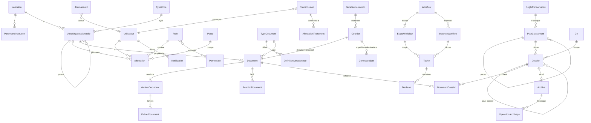

# 04. Modèle de données initial

## 4.1 Conventions

- PostgreSQL 16. Clés primaires `bigint` générées (`GENERATED ALWAYS AS IDENTITY`) pour les jointures ; chaque objet métier exposé porte aussi un `uuid` unique, seul identifiant visible dans l'API et les URL (pas d'identifiant séquentiel devinable).
- Toutes les tables métier portent `institution_id` (non nul), même en mode mono-institution : le passage en multi-institutions ne demande alors aucune migration de structure.
- Horodatages en `timestamptz` (UTC en base, fuseau de l'institution à l'affichage).
- Colonnes communes : `cree_le`, `cree_par_id`, `modifie_le`, `modifie_par_id`.
- **Aucune suppression physique** des objets métier par l'application : statuts (`actif`, `desactive`, `elimine`). Les clés étrangères sont en `ON DELETE RESTRICT` sauf mention contraire. La seule suppression de contenu est l'élimination archivistique (document 05, circuit W6), qui efface les fichiers et conserve une notice minimale et le procès-verbal.
- Libellés configurables traduits : colonnes `libelle_fr` et `libelle_ar` (deux langues demandées ; une table de traductions sera introduite si une troisième langue est requise).
- Métadonnées personnalisées : définition en table (`DefinitionMetadonnee`), valeurs en JSONB validées par le service contre la définition, avec index GIN.
- Migrations : Django, versionnées dans le dépôt, réversibles quand c'est possible, testées sur une copie de la base de recette avant production.

Les noms des entités sont ceux de la demande, sans accents dans le code (`EtapeWorkflow`, `RegleConservation`…). Une adaptation : **Direction, Service et Agence sont des types d'une même entité `UniteOrganisationnelle`** organisée en arbre. Coder trois tables imposerait une organisation à trois niveaux ; or chaque institution a la sienne (direction générale, département, bureau, antenne régionale…). Les types d'unités sont configurables, avec les types initiaux Direction générale, Direction, Département, Service, Bureau, Agence.

## 4.2 Diagramme des entités principales

`Transmission`, `Validation` et `Affectation` (au sens de la demande) sont détaillés en 4.3.5 : pour éviter l'ambiguïté avec l'affectation d'un utilisateur à une unité, l'affectation d'un traitement s'appelle `AffectationTraitement`, et la validation est un type de `Decision`.

## 4.3 Entités

### 4.3.1 Organisation et paramètres

| Entité | Champs principaux | Contraintes et index |
|---|---|---|
| `Institution` | uuid, code, nom_fr, nom_ar, sigle, logo (clé objet), couleurs, adresse, téléphone, courriel, fuseau, langue_defaut, statut | `code` unique |
| `ParametreInstitution` | institution, cle, valeur (JSONB), modifie_le, modifie_par | unique (institution, cle) ; clés connues validées par schéma ; toute modification est auditée |
| `TypeUnite` | institution, code, libelle_fr, libelle_ar, ordre | unique (institution, code) |
| `UniteOrganisationnelle` | institution, uuid, type, parent (nullable), code, sigle, libelle_fr, libelle_ar, chemin (chemin matérialisé des identifiants, par exemple `/1/4/9/`), actif | unique (institution, code) ; index `varchar_pattern_ops` sur `chemin` pour les requêtes « unité et sous-unités » (préfixe) ; une unité ne peut être désactivée tant qu'elle a des sous-unités, affectations ou postes actifs. Le chemin texte remplace `ltree` (lot 2) : même usage, sans extension PostgreSQL à installer |
| `Poste` | institution, unite, intitule_fr, intitule_ar, superieur (Poste, nullable) | Donne la hiérarchie pour l'escalade |

### 4.3.2 Identité et accès

| Entité | Champs principaux | Contraintes et index |
|---|---|---|
| `Utilisateur` | institution, uuid, identifiant, nom, prenom, nom_ar, courriel, mot_de_passe (Argon2id), mfa_actif, niveau_habilitation, langue, actif, derniere_connexion, identifiant_externe (OIDC) | `identifiant` unique sur toute l'installation (la connexion ne demande pas l'institution ; écart assumé au lot 1) ; unique `identifiant_externe` si présent ; contrainte : rattachement à une institution obligatoire sauf superadministrateur technique |
| `Role` | institution, code, libelle_fr, libelle_ar, systeme (bool), mfa_requis | unique (institution, code) ; un rôle `systeme` ne peut pas être supprimé |
| `Permission` | code (par exemple `document.telecharger`), description | catalogue fixe, chargé par migration |
| `RolePermission` | role, permission | clé primaire composée |
| `Affectation` | utilisateur, unite, role, poste (nullable), etendue_sous_unites (bool), date_debut, date_fin, attribuee_par | index (utilisateur, date_fin) ; CHECK date_fin > date_debut ; un administrateur ne peut pas créer d'affectation pour lui-même (contrôle de service et audit) |
| `Delegation` | delegant, delegataire, date_debut, date_fin, perimetre (rôles ou circuits) | CHECK delegant ≠ delegataire |
| `AccesExplicite` | institution, objet_type, objet_id, beneficiaire (utilisateur ou unité), droits, origine (transmission, tâche, partage), expire_le, revoque_le | index (objet_type, objet_id) et (beneficiaire) ; utilisé par `filtrer_visibles` |
| `SessionUtilisateur`, `TentativeConnexion` | utilisateur, adresse IP, agent, début, fin, résultat | purge selon la politique de conservation des journaux |

### 4.3.3 Documents

| Entité | Champs principaux | Contraintes et index |
|---|---|---|
| `TypeDocument` | institution, code, libelle_fr, libelle_ar, categorie, formats_autorises, confidentialite_defaut, serie_numerotation (nullable), workflow_defaut (nullable), actif | unique (institution, code) |
| `DefinitionMetadonnee` | type_document, code, libelle_fr, libelle_ar, nature (texte, date, nombre, liste, référence), obligatoire, valeurs_liste, ordre | unique (type_document, code) |
| `Document` | institution, uuid, reference (nullable avant enregistrement), titre, objet, type, date_document, date_reception, unite_proprietaire, expediteur, destinataire, confidentialite, mots_cles (text[]), metadonnees (JSONB), statut, version_courante, regle_conservation (héritée du dossier ou forcée), date_echeance_conservation, sort_final, gele (bool), texte_indexe (`tsvector`), cree_par, cree_le, modifie_le | unique (institution, reference) quand non nulle ; index GIN sur `texte_indexe`, `mots_cles`, `metadonnees` ; index (institution, unite_proprietaire, statut) ; index trigramme sur `reference` et `titre` |
| `VersionDocument` | document, numero, commentaire, creee_par, creee_le, statut (brouillon, validée) | unique (document, numero) ; une version validée est immuable (déclencheur) |
| `FichierDocument` | version, role (principal, pièce jointe, aperçu, PDF/A OCR), nom_origine, type_mime_detecte, taille, sha256, cle_objet, etat_analyse (en attente, sain, infecté, refusé), texte_extrait, langue_ocr, cree_le | unique `cle_objet` ; index (institution, sha256) pour les doublons ; le fichier n'est lisible que si `etat_analyse = sain` |
| `RelationDocument` | source, cible, nature (réponse à, annule, remplace, annexe de, voir aussi) | unique (source, cible, nature) ; CHECK source ≠ cible |
| `Annotation` | document, version, auteur, texte, page, visibilite | — |

Doublons : à l'envoi, si un fichier de même empreinte existe dans un document que l'utilisateur **peut voir**, il est averti et peut lier ou poursuivre ; si le document n'est pas visible pour lui, aucune information n'est révélée.

### 4.3.4 Classement et dossiers

| Entité | Champs principaux | Contraintes et index |
|---|---|---|
| `PlanClassement` | institution, parent, code, libelle_fr, libelle_ar, chemin (`ltree`), regle_conservation, confidentialite_min, actif | unique (institution, code) |
| `Dossier` | institution, uuid, reference, intitule, plan_classement, parent (sous-dossier), unite_proprietaire, responsable, categorie, confidentialite, statut (ouvert, clos, archivé, éliminé), date_ouverture, date_cloture, gele | unique (institution, reference) ; CHECK date_cloture ≥ date_ouverture ; un dossier clos n'accepte plus de document |
| `DocumentDossier` | document, dossier, rattache_par, rattache_le, principal (bool) | unique (document, dossier) ; au plus un dossier principal par document (index unique partiel) |
| `RegleConservation` | institution, code, libelle, duree_utilite_administrative (mois), evenement_depart (clôture, date du document, fin de contrat…), sort_final (conservation, élimination, tri), reference_reglementaire | unique (institution, code) |

### 4.3.5 Courrier, transmissions, circuits

| Entité | Champs principaux | Contraintes et index |
|---|---|---|
| `SerieNumerotation` | institution, code, gabarit (`{SIGLE}/{AAAA}/{SEQ:5}`), portee (année, unité, catégorie), remise_a_zero (annuelle ou jamais) | unique (institution, code) |
| `CompteurSerie` | serie, cle_portee (par exemple `2026` ou `2026-DAF`), valeur | unique (serie, cle_portee) ; incrémenté par `SELECT … FOR UPDATE` dans la transaction qui crée l'objet : pas de doublon et pas de trou si la transaction échoue |
| `Correspondant` | institution, nature (personne, organisme), nom, nom_ar, adresse, courriel | index trigramme sur le nom (saisie assistée) |
| `Courrier` | institution, uuid, sens (entrant, sortant), reference, serie, document, date_reception ou date_expedition, expediteur, destinataires, objet, priorite, unite_responsable, date_limite, statut, mode (papier, courriel, porteur…), accuse_reception (fichier), preuve_expedition (fichier), courrier_lie (réponse à) | unique (institution, reference) ; index (institution, sens, date) et (unite_responsable, statut, date_limite) |
| `Transmission` | institution, objet_type, objet_id, emetteur, unite_destinataire ou utilisateur_destinataire, motif (attribution, information, avis), instruction, date_limite, envoyee_le, recue_le, statut | index (destinataire, statut) ; créée dans la même transaction que l'`AccesExplicite` et la notification : une transmission ne peut pas être perdue |
| `AffectationTraitement` | transmission, agent, affectee_par, affectee_le, statut, cloturee_le | — |
| `Workflow` | institution, code, libelle, applicable_a (types de documents ou de courrier), version, actif | unique (institution, code, version) ; une instance garde la version du circuit avec laquelle elle a démarré |
| `EtapeWorkflow` | workflow, ordre, code, libelle, obligatoire, responsable (rôle et unité, ou poste), delai_jours, actions_permises, mode (simple ; parallèle au lot 13), etape_retour | unique (workflow, ordre) |
| `InstanceWorkflow` | workflow, objet_type, objet_id, etape_courante, statut, demarree_le, terminee_le | index (objet_type, objet_id) |
| `Tache` | instance, etape, titulaire (utilisateur ou unité), delegue_a, date_limite, statut, prise_le, terminee_le | index (titulaire, statut, date_limite) |
| `Decision` | tache, auteur, agissant_pour (délégation), nature (valider, rejeter, retourner, demander complément, réaffecter, visa), motif, decidee_le | motif obligatoire pour rejet et retour (CHECK) ; table en ajout seul |

### 4.3.6 Notifications, archives, audit

| Entité | Champs principaux | Contraintes et index |
|---|---|---|
| `Notification` | utilisateur, nature, objet_type, objet_id, titre, lue_le, envoyee_courriel_le, creee_le | index (utilisateur, lue_le) ; le texte ne reprend pas le contenu d'un objet confidentiel |
| `Archive` | dossier, versement, date_versement, statut (intermédiaire, définitive), cote, metadonnees_archivistiques, date_echeance, sort_final | unique (dossier) |
| `Versement` | institution, reference, unite_versante, archiviste, date, bordereau (fichier), statut | — |
| `Gel` | institution, motif (contentieux, enquête, demande de l'autorité), reference_decision, objets, debut, fin, pose_par, leve_par | tant qu'un gel actif couvre un objet, toute élimination est refusée (contrôle de service et contrainte vérifiée par déclencheur) |
| `DemandeCommunication` | demandeur, objet, motif, statut, decide_par, delai | — |
| `OperationArchivage` | nature (versement, transfert, élimination, communication, contrôle d'intégrité), objets, auteur, valideur, proces_verbal (fichier), date | table en ajout seul |
| `JournalAudit` | id, horodatage, institution, acteur, agissant_pour, adresse_ip, action, objet_type, objet_id, resultat (succès, refus, erreur), details (JSONB, sans contenu confidentiel), empreinte_precedente, empreinte | ajout seul : droits SQL du rôle applicatif limités à INSERT et SELECT, déclencheur refusant UPDATE et DELETE ; `empreinte = SHA-256(empreinte_precedente ∥ contenu canonique)` ; partitionnement par mois ; index (institution, horodatage), (objet_type, objet_id), (acteur) |
| `ScellementAudit` | date, dernier_id, empreinte, exporte_vers | empreinte de fin de journée exportée hors de la base (fichier signé, stockage WORM) pour détecter une réécriture de la chaîne |

## 4.4 Règles de cohérence transverses

1. Création d'un courrier : document, fichiers, numéro, transmission initiale et événement d'audit dans **une seule transaction**. En cas d'échec, rien n'est créé et le numéro n'est pas consommé.
2. Les octets sont écrits d'abord dans le bucket de quarantaine ; la ligne `FichierDocument` est créée dans la transaction ; un worker analyse et publie. Un nettoyage périodique supprime les objets orphelins (envoi interrompu) après 24 heures.
3. Changement de confidentialité, de propriétaire ou de dossier principal : recalcul des accès explicites concernés et audit.
4. Tout accès en lecture à un document de niveau 2 ou plus est journalisé.
5. Mode multi-institutions : politiques RLS sur toutes les tables portant `institution_id` ; tests automatisés qui tentent des lectures croisées.

## 4.5 Dictionnaire de données

Le dictionnaire complet (chaque colonne, type, nullabilité, valeurs, règle) sera produit au lot 1 à partir des modèles Django et tenu à jour par génération automatique, pour qu'il ne diverge pas du schéma réel.
