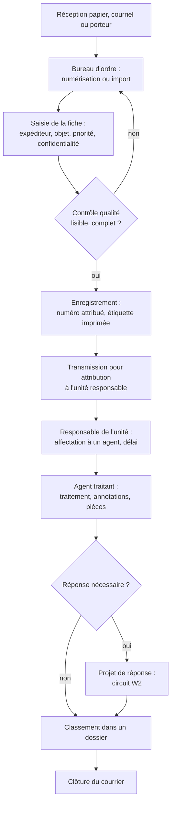
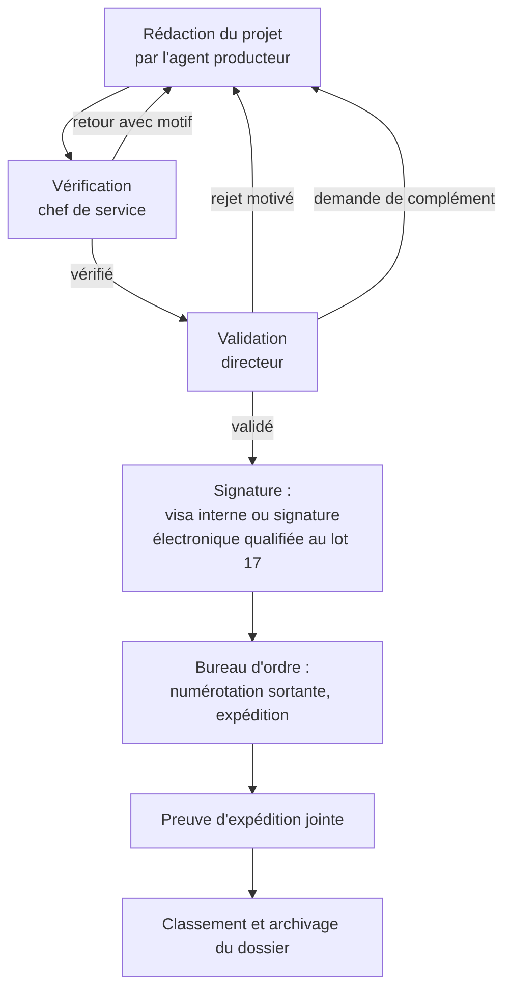
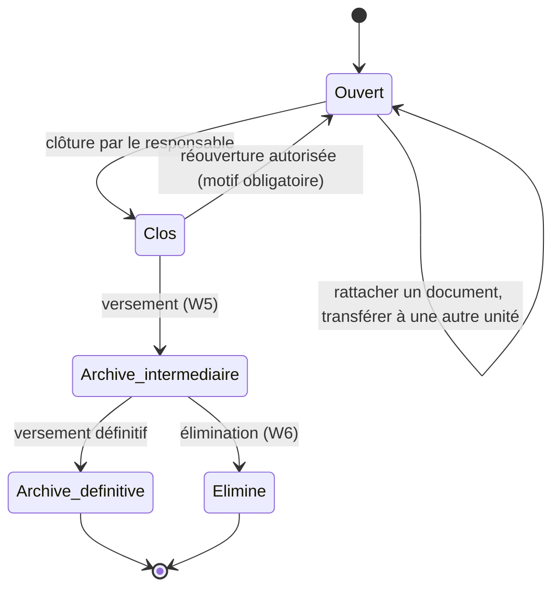
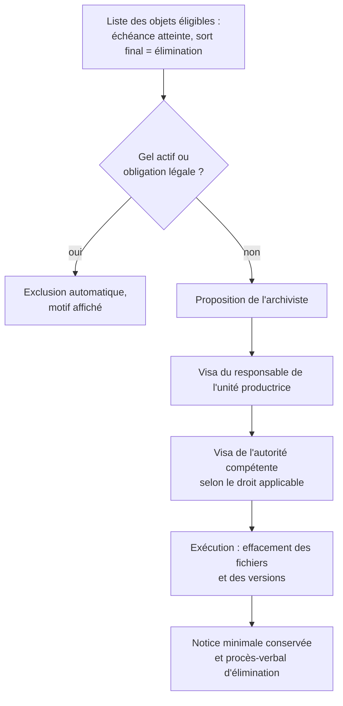

# 05. Principaux workflows administratifs

Les circuits ci-dessous sont des **modèles fournis à l'installation**. L'administrateur fonctionnel peut modifier les étapes, responsables et délais ; les invariants de sécurité (motif obligatoire, historique, gel, double validation des éliminations) ne sont pas désactivables.

Chaque décision produit une ligne `Decision` et un événement d'audit horodaté ; chaque changement de titulaire produit une notification.

## W1. Courrier entrant

Règles :

- Le numéro est attribué à l'enregistrement définitif, pas à l'ouverture du formulaire (pas de trous dus aux abandons).
- Un courrier confidentiel transmis à une unité n'est visible que des membres habilités au niveau requis ; les autres voient la tâche sans le contenu ou ne la voient pas (paramètre).
- Le délai de traitement part de la date de réception ; une alerte est émise à J-2 (paramétrable) et au dépassement.
- Copie pour information : transmission parallèle sans tâche de traitement, accès en lecture seulement.

## W2. Courrier sortant et document soumis à validation

Règles :

- Chaque soumission crée une nouvelle version ; la version validée est figée (immuable) et c'est elle qui est expédiée.
- Rejet, retour et demande de complément exigent un motif ; le motif est visible de l'auteur.
- Le « visa » dans l'application atteste qui a validé et quand ; il **n'est pas une signature électronique au sens juridique**. Si l'institution requiert une signature électronique, l'étape D appelle le prestataire retenu (hypothèse H8) et stocke le fichier signé et sa preuve.
- Délégation : une décision prise par un délégataire porte les deux noms (« X pour Y »).

## W3. Transmission entre unités et réaffectation

- Une transmission a un motif : attribution (une seule unité responsable), information ou avis (plusieurs unités possibles).
- L'unité destinataire accuse réception (automatiquement à l'ouverture ou explicitement).
- Une réaffectation vers une autre unité exige le droit de transmettre et un motif ; l'unité d'origine en est notifiée.
- Une transmission non prise en charge dans le délai est signalée au responsable de l'unité destinataire, puis au supérieur hiérarchique (escalade, lot 13).

## W4. Dossier administratif

La date de clôture déclenche le calcul de l'échéance de conservation à partir de la règle du plan de classement.

## W5. Versement aux archives

1. L'archiviste ou l'unité propose une liste de dossiers clos arrivés à échéance d'utilité courante.
2. L'unité versante vérifie et complète les métadonnées archivistiques.
3. Le système contrôle l'intégrité (recalcul des empreintes de tous les fichiers) et convertit si nécessaire vers un format de conservation (PDF/A).
4. L'archiviste accepte le versement ; un bordereau de versement est produit et signé (visa).
5. Les droits changent : l'unité versante garde la consultation, la modification est fermée, les communications passent par une demande (lot 15).

## W6. Élimination

Règles :

- Deux validations distinctes au minimum ; la personne qui propose ne peut pas valider seule.
- L'exécution vérifie de nouveau l'absence de gel au moment de l'effacement.
- L'effacement porte sur les objets du stockage (y compris versions et aperçus) ; les sauvegardes expirent selon leur propre cycle, ce qui est mentionné au procès-verbal.
- Le procès-verbal et la notice minimale (référence, intitulé, dates, règle appliquée, décision) sont conservés sans limite.

## W7. Demande de communication d'archives (lot 15)

Demande motivée → avis de l'unité productrice si l'objet est restreint → décision de l'archiviste → accès en lecture limité dans le temps → retour automatique à l'expiration. Chaque étape est journalisée.

## Délais et relances (tous circuits)

| Événement | Action |
|---|---|
| Échéance proche (J-2 par défaut) | Notification au titulaire |
| Échéance dépassée | Notification au titulaire et à son responsable ; marquage « en retard » dans les tableaux de bord |
| Dépassement prolongé (paramétrable) | Escalade au supérieur hiérarchique défini par les postes (lot 13) |
| Absence déclarée du titulaire | Les nouvelles tâches vont au délégataire ; les tâches en cours lui sont proposées |
