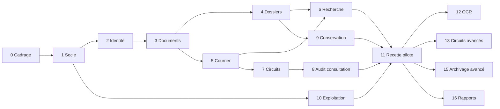

# 07. Plan de développement par lots

Chaque lot se termine par une démonstration en recette et un compte rendu : livrables, tests réalisés, limites restantes, prochaines actions. **Un lot n'est déclaré terminé que si son code, ses migrations, ses tests automatisés et ses contrôles d'accès sont réalisés et passent dans l'intégration continue.**

Règles communes à tous les lots :

- Chaque point d'API a des tests d'autorisation (accès autorisé, refusé, hors périmètre, objet inexistant indiscernable d'un objet interdit).
- Chaque opération modifiante écrit un événement d'audit, vérifié par test.
- Tout libellé visible existe en français et en arabe, et l'écran est vérifié en RTL.
- Couverture de tests du backend d'au moins 80 % sur les modules métier, 100 % des règles du module `acces`.
- Analyse statique et de dépendances (ruff, mypy, bandit, pip-audit, npm audit) sans alerte élevée non traitée.

## Phase MVP

| Lot | Contenu | Livrables | Critères d'acceptation |
|---|---|---|---|
| **0. Cadrage** (ce dossier) | Besoins, architecture, modèle, workflows, risques, plan | Documents 01 à 08 | Hypothèses H1 à H6 confirmées ; architecture et périmètre validés par écrit |
| **1. Socle technique** | Dépôt GED, structure backend et frontend, Docker Compose (dev, recette), PostgreSQL, MinIO, Redis, Nginx, intégration continue, module `noyau` (institution, paramètres, numérotation), module `audit` (chaînage, scellement), i18n FR/AR et RTL, page de connexion | Code, migrations, `docker compose up` fonctionnel, README d'installation, dictionnaire de données généré | Installation sur une machine vierge en moins de 30 min avec le guide ; tests passants en CI ; un événement d'audit modifié en base est détecté par la vérification de la chaîne ; 50 numéros demandés en parallèle sur une série donnent 50 numéros distincts et consécutifs |
| **2. Organisation et identité** | Types d'unités, arbre des unités, postes, utilisateurs, rôles, permissions, affectations, délégations, module `acces`, MFA TOTP, politique de mot de passe, verrouillage, révocation des sessions, journal des connexions ; écrans d'administration | Code, migrations, matrice de tests d'autorisation | La matrice du document 03 est entièrement couverte par des tests ; un administrateur ne peut pas s'attribuer un rôle ; un compte désactivé perd ses sessions immédiatement ; MFA exigé pour les rôles marqués ; 10 échecs de connexion verrouillent le compte et sont journalisés |
| **3. Documents et stockage** | Types de documents, métadonnées personnalisées, envoi de fichiers, quarantaine, type réel, ClamAV, SHA-256, doublons, versions, pièces jointes, relations, aperçu PDF et images, téléchargement contrôlé | Code, migrations, tests | Un fichier EICAR est refusé ; un `.exe` renommé en `.pdf` est refusé ; un fichier n'est jamais accessible par une URL sans contrôle (test sur les clés d'objet) ; une nouvelle version n'écrase pas la précédente ; l'empreinte recalculée correspond |
| **4. Classement et dossiers** | Plan de classement, dossiers et sous-dossiers, rattachement, clôture et réouverture, transfert entre unités, confidentialité des dossiers | Code, migrations, tests, écrans | Un dossier clos refuse les rattachements ; une réouverture exige un motif et est journalisée ; un dossier confidentiel n'apparaît dans aucune liste pour un non-habilité |
| **5. Courrier** | Séries configurables, registres entrant et sortant, correspondants, priorité, délais, accusés et preuves, bordereaux et étiquettes, écran d'enregistrement en une page | Code, migrations, tests, maquettes validées | Test de concurrence : 200 courriers enregistrés par 20 sessions simultanées, aucun doublon ni trou ; changement d'année : la série repart à 1 si configurée ; un agent du bureau d'ordre enregistre un courrier en moins de 2 min (test utilisateur) |
| **6. Recherche** | Index plein texte FR et AR (texte des PDF natifs), recherche multicritère, filtres, tri, pagination, export autorisé et journalisé | Code, tests, jeu de requêtes de référence | Aucun résultat, extrait ni compteur ne révèle un objet non autorisé (tests dédiés) ; 95 % des recherches en moins de 2 s sur 500 000 documents de test ; requêtes arabes de référence validées par des utilisateurs |
| **7. Transmissions et circuits élémentaires** | Transmissions (attribution, information, avis), affectations, accusé de réception, circuits linéaires configurables, décisions (valider, rejeter, retourner, demander un complément), corbeille des tâches, notifications internes, échéances | Code, migrations, tests, circuits W1 et W2 configurés | Une transmission est créée avec ses droits et sa notification ou pas du tout ; rejet sans motif impossible ; la version validée est figée ; retard signalé au bon titulaire |
| **8. Audit : consultation et export** | Écran de consultation filtré pour l'auditeur, export CSV avec empreinte, vérification de la chaîne à la demande | Code, tests | Toutes les familles d'événements du module J sont produites et consultables ; l'export est lui-même journalisé |
| **9. Conservation de base et gel** | Règles de conservation, calcul des échéances, gel et levée | Code, migrations, tests | Une élimination est impossible sur un objet gelé (test au niveau service et base) |
| **10. Exploitation** | Docker Compose de production, TLS, sauvegardes (pgBackRest, restic), restauration scriptée, supervision et alertes, procédures | Scripts, guide d'installation, procédure de sauvegarde et restauration, procédure d'incident | Restauration complète sur une machine vierge réussie et chronométrée (RTO mesuré) ; perte mesurée inférieure au RPO convenu ; alerte reçue sur sauvegarde échouée simulée |
| **11. Recette, pilote, reprise** | Recette fonctionnelle avec le bureau d'ordre pilote, tests de charge, test d'intrusion, corrections ; reprise optionnelle des pièces de la GRH | Procès-verbal de recette, rapport de test d'intrusion, guides utilisateur et administrateur | Aucun défaut bloquant ou majeur ouvert ; vulnérabilités élevées corrigées ; utilisateurs pilotes formés |

## Phase fonctionnalités avancées

| Lot | Contenu | Critères d'acceptation principaux |
|---|---|---|
| 12. Acquisition avancée et OCR | OCRmyPDF (FR, AR), PDF/A, dossier surveillé, import par lot, séparation et assemblage de pages, redressement, contrôle qualité, agent de numérisation, extraction de métadonnées simples | Taux de mots reconnus mesuré sur l'échantillon de référence et publié ; OCR exécuté sur place sans appel externe ; recherche dans le texte OCR soumise aux mêmes droits |
| 13. Circuits avancés | Étapes parallèles, conditions, étapes facultatives, escalade hiérarchique, délégation automatique en cas d'absence | Circuits de test parallèles et conditionnels couverts par des tests ; aucune tâche orpheline après réaffectation ou départ d'un agent |
| 14. Notifications par courriel | SMTP de l'institution, modèles configurables, préférences, résumé quotidien | Aucun contenu confidentiel dans un courriel (seulement un lien) |
| 15. Archivage avancé | Versements, bordereaux, métadonnées archivistiques, demandes de communication, éliminations avec procès-verbal, contrôle périodique d'intégrité | Circuit W6 avec double validation ; contrôle d'intégrité mensuel sur tous les fichiers archivés et rapport |
| 16. Tableaux de bord et rapports | Indicateurs du chapitre 5 de la demande, filtres, exports PDF et Excel | Chiffres identiques entre tableau de bord et recherche équivalente ; indicateurs calculés sur le seul périmètre visible ; exports journalisés |
| 17. Signature électronique | Intégration du prestataire retenu, conservation des preuves de signature | Signature vérifiable hors de l'application avec les outils du prestataire |
| 18. Multi-institutions | Activation du mode, RLS, administration par institution, préfixes ou buckets dédiés | Tests de lecture croisée négatifs sur toutes les tables et tous les points d'API |
| 19. Haute disponibilité (si requise) | Réplication PostgreSQL, MinIO distribué, second nœud applicatif | Bascule testée, objectifs de disponibilité mesurés |

## Ordre et dépendances

Le lot 10 (exploitation) avance en parallèle dès le lot 1 : la sauvegarde est en place avant que des données réelles n'entrent dans le système.

Documentation de l'étape 8 de la demande (guides, API, dictionnaire, procédures, plan de maintenance) : produite au fil des lots et consolidée au lot 11. La documentation de l'API est générée depuis le code (OpenAPI).
